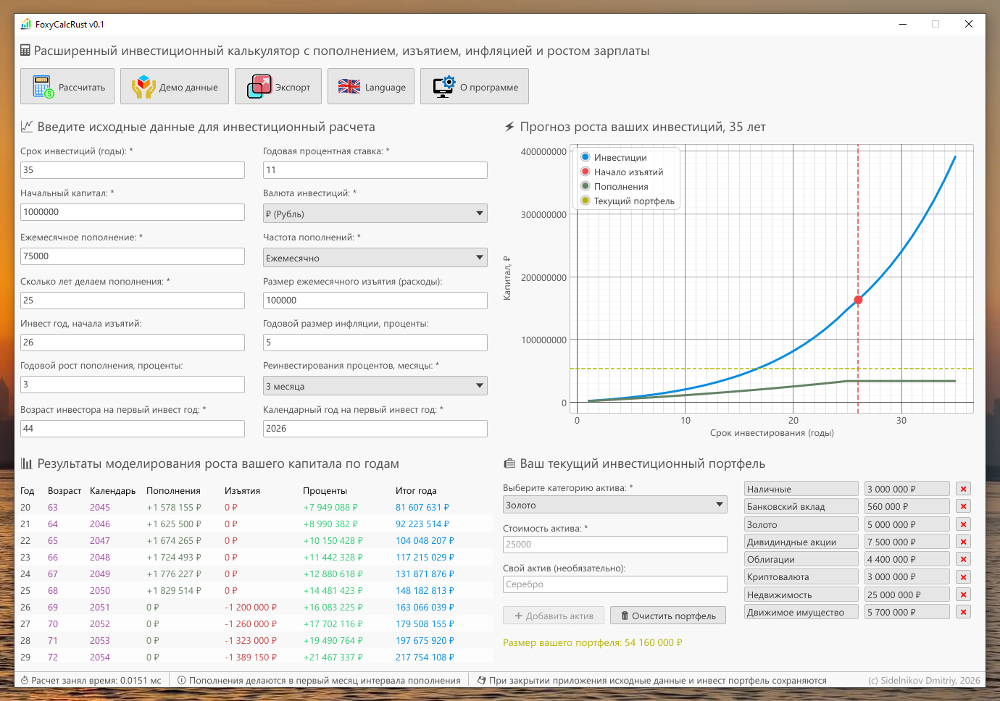

# FoxyCalcRust

## Overview

An advanced compound interest investment calculator created to demonstrate GUI development in Rust using `eframe` and `egui`.

## Main Features

* **Flexible Calculations:** Supports up to 14 customizable input parameters.
* **Detailed Breakdown:** Stores calculated investment forecast data in a colorful, easy-to-read table.
* **Interactive Visualization:** Displays investment results on an interactive chart, clearly showing the impact of compound interest, deposits, and withdrawals.
* **Portfolio Modeling:** Allows you to model your current investment portfolio across different assets and display its total value on the chart.
* **HTML Export:** Exports all calculated data and results to a standalone HTML report.
* **Bilingual UI:** Supports both English and Russian interface languages.

## Screenshots



## Building and Running

### Prerequisites

* **OS:** Windows (tested on Windows 10/11)
* **Rust:** Download and install from [rust-lang.org](https://rust-lang.org)
* **Git:** Download and install from [git-scm.com](https://git-scm.com)

### Steps

Clone the repository and navigate to the project directory:

```bash
git clone https://github.com/nirvikalpa7/FoxyCalcRust.git
cd FoxyCalcRust
```

Build and run the application (use `--release` for optimal GUI performance):

```bash
cargo run --release
```

## Useful cargo commands

```bash
# Creating and configuring a project
cargo new some-new-app
cargo add egui-extras -F image
cargo remove some-crate
cargo tree
cargo update

# Build and run
cargo check
cargo run
cargo build
cargo build --release
cargo build --verbose
cargo clean 
rustup target list --installed

# Linters and formatting
cargo clippy
cargo clippy --fix
cargo clippy -- -D warnings
cargo fmt
cargo fmt --check
cargo fix

# Testing and documentation
cargo test
cargo test --verbose
cargo test -- --nocapture
cargo doc
cargo doc --open
```

## Author & Contacts

© Sidelnikov Dmitriy, 2026

* **Email:** [nirvikalpa@yandex.ru](mailto:nirvikalpa@yandex.ru)
* **Telegram:** [@SpringDayInTheForest](https://t.me)
* **LinkedIn:** [Dmitry Sidelnikov](https://www.linkedin.com/in/dmitry-sidelnikov/)
